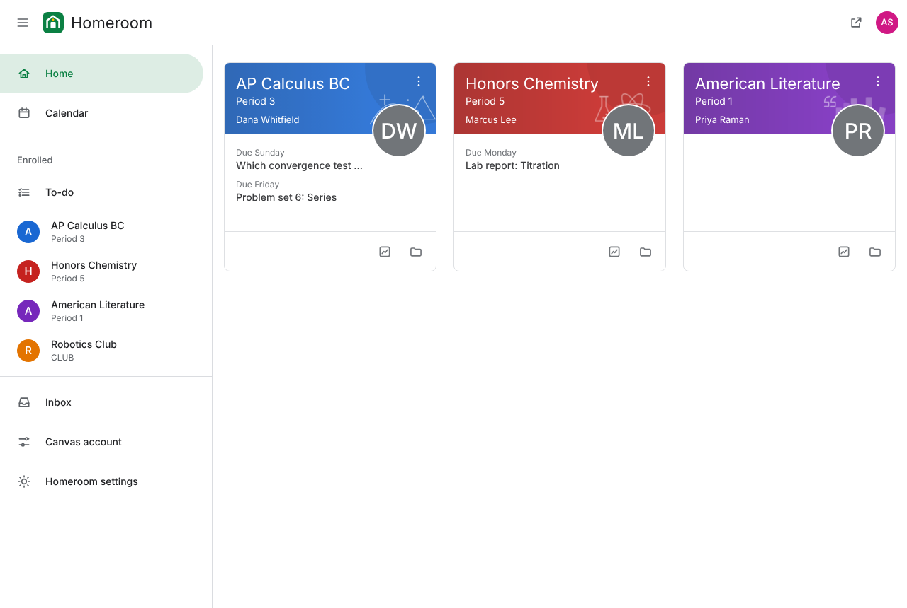
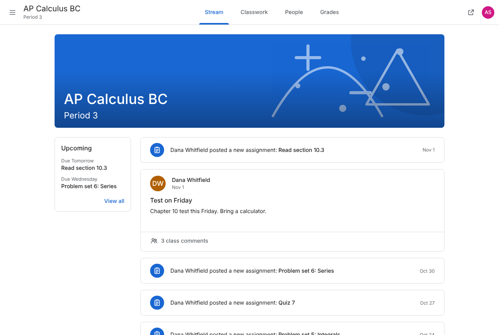
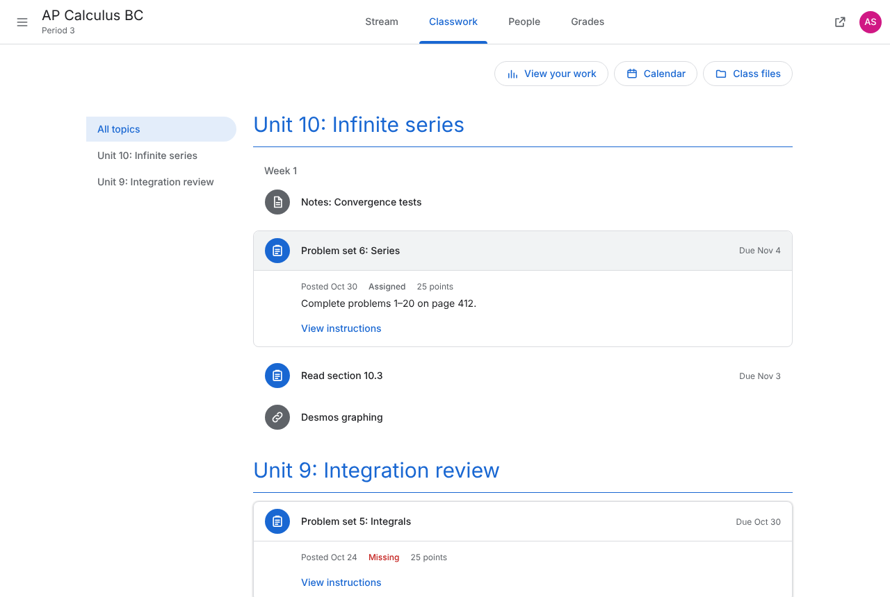
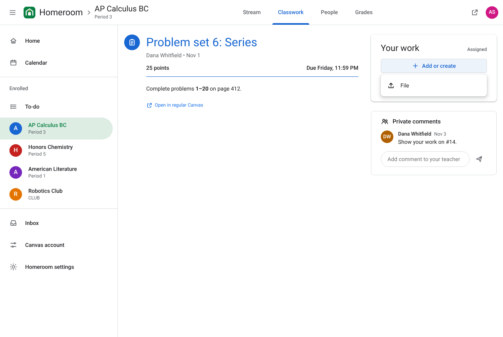
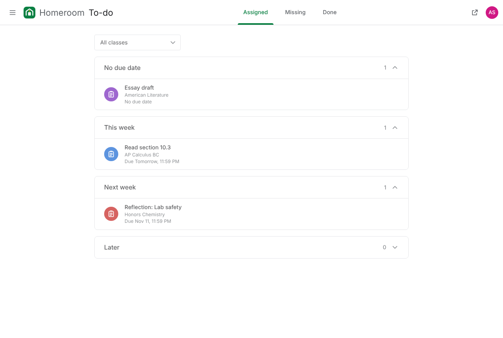
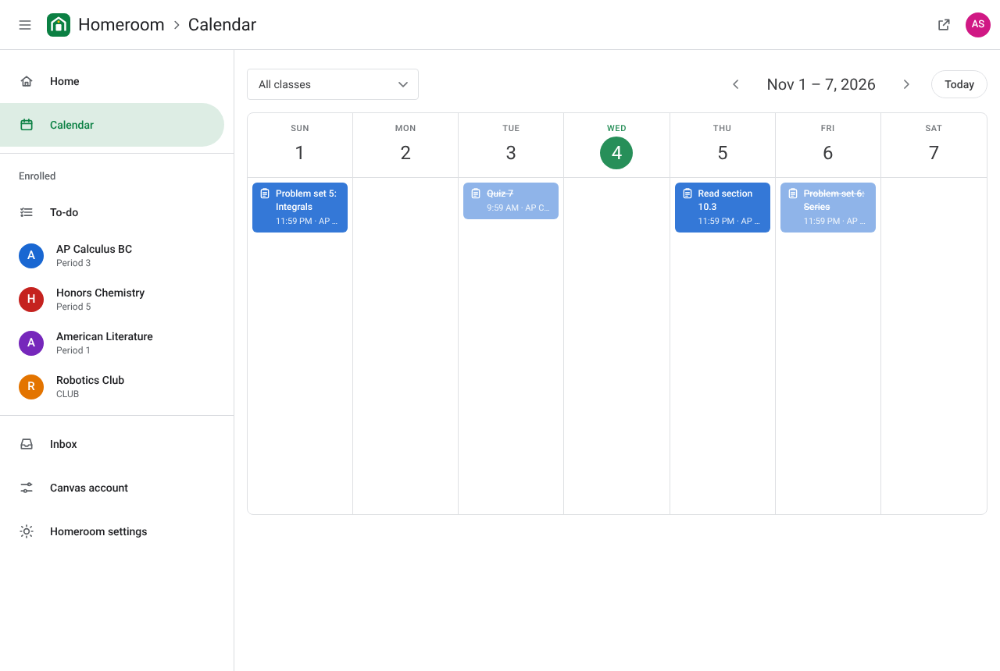
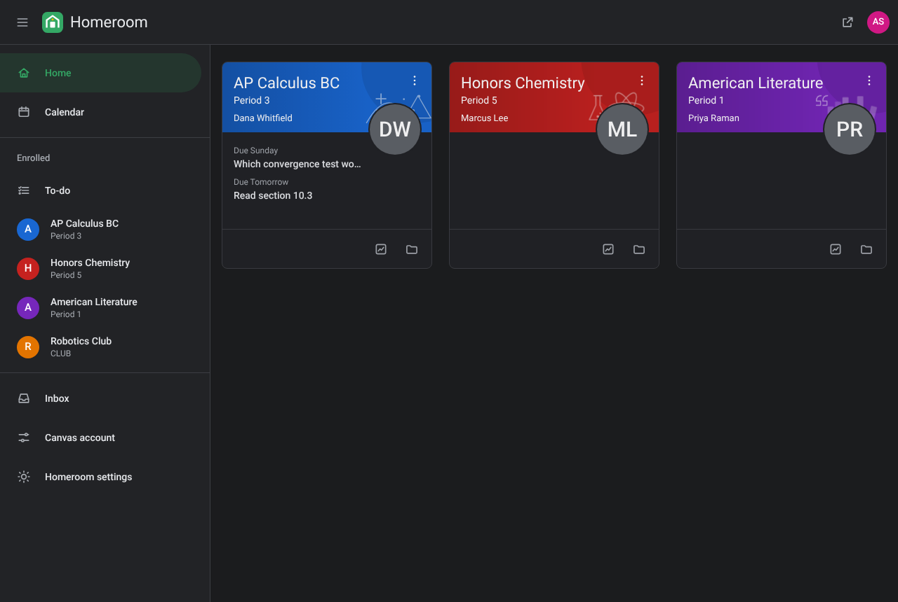

# Homeroom

A bookmark (or, optionally, a Chrome extension) that gives Canvas a clean, card-based classroom layout: class cards, a Stream,
Classwork organized by topic, People, a To-do list and a Calendar. Your classes, assignments and grades
all come straight from Canvas.



| Stream | Classwork | Assignment |
| --- | --- | --- |
|  |  |  |
| **To-do** | **Calendar** | **Dark theme** |
|  |  |  |

## What it does

- **Home**: a card for every class on your Canvas dashboard, with a banner drawn for its subject, the teacher,
  and what's due next. Change a class's color from the card's menu (saved to Canvas).
- **Stream**: announcements and new assignments, newest first, with an Upcoming box.
- **Classwork**: modules shown as topics, with a topic list to jump around. Expand any item for details.
  Classes without modules are grouped by assignment group.
- **People**: teachers and classmates.
- **Grades** ("Your work"): every assignment with its status and score, filters for Assigned, Returned and Missing, and your overall grade.
- **Assignment page**: instructions, then a **Your work** card where you can add a file, link or text and **Turn in**,
  or **Mark as done** for work with nothing to hand in. **Private comments** to your teacher.
- **To-do**: Assigned, Missing and Done across all classes, grouped by week, with a class filter.
- **Calendar**: a week view of everything due, color-coded by class.
- Light and dark themes, phone-friendly layout, and the browser back button works throughout.

Anything Homeroom doesn't redo (quizzes, discussions, files, inbox and so on) opens in regular Canvas
with a **Back to Homeroom** button in the corner. Every Homeroom page also has an **Open in Canvas** button.

## Install (bookmark, no extension needed)

1. Open [`index.html`](index.html) (the install page) in your browser.
2. Show the bookmarks bar (`Ctrl+Shift+B`, or `Cmd+Shift+B` on a Mac).
3. Drag the yellow **Homeroom** button onto the bar.
4. Open any Canvas page and click **Homeroom**. Canvas turns into Homeroom in that tab.

Can't drag? Copy the contents of [`dist/bookmarklet.txt`](dist/bookmarklet.txt), create a new bookmark, and paste it in as the URL.

How the bookmark behaves:
- Moving around Homeroom stays in the same tab without reloading, and the back button works.
- Pages Homeroom doesn't redo (quizzes, discussions, files…) open in a new tab of regular Canvas, so Homeroom stays open.
- Reloading brings regular Canvas back; click the bookmark again to return. Clicking it while Homeroom is open also goes back to Canvas.
- Some school-managed Chromebooks block bookmarks like this. If clicking does nothing, that's why.

### Extension version (optional)

If you can install extensions, the same app also builds as a Chrome extension that switches on by itself:
unzip [`homeroom.zip`](homeroom.zip), open `chrome://extensions`, turn on **Developer mode**, click **Load unpacked**
and pick the folder. It runs on `*.instructure.com`; for a custom Canvas address, click the toolbar icon and choose
**Use Homeroom on this site**.

## How it works

When you click the bookmark, Homeroom stops Canvas's timers, replaces the page (which drops Canvas's listeners)
and draws Homeroom instead, moving between pages with the History API. The extension does the same before Canvas's
scripts ever run. Both use the Canvas REST API with your existing login. Nothing is sent anywhere except your school's Canvas.

| Data | Canvas API |
| --- | --- |
| Classes, teachers, grades, colors | `/api/v1/courses`, `/api/v1/dashboard/dashboard_cards`, `/api/v1/users/self/colors` |
| Stream | `/api/v1/announcements`, `/api/v1/courses/:id/assignments` |
| Classwork | `/api/v1/courses/:id/modules`, `/api/v1/courses/:id/assignment_groups` |
| People | `/api/v1/courses/:id/users` |
| To-do, Calendar | `/api/v1/courses/:id/assignments?include[]=submission`, `/api/v1/planner/items` |
| Turn in, comments, mark as done | `/api/v1/courses/:id/assignments/:id/submissions`, `/submissions/self/files`, `/api/v1/planner/overrides` |

## Develop

```bash
npm install
npm run build   # bundles src/ into the bookmark (dist/, index.html), extension/ and homeroom.zip
npm test        # runs both versions in Chromium against a mock Canvas (scripts/mock-canvas.mjs)
```

| Path | What it is |
| --- | --- |
| `src/bookmarklet.js` | Bookmark entry point: takes over the current Canvas tab |
| `src/content/main.js` | Extension entry point: takes over a page or adds the Back to Homeroom button |
| `src/install.html` | Install page template (the drag button) |
| `src/content/app.js` | App shell: top bar, menu, routing, events |
| `src/content/views/` | One file per page |
| `src/content/data.js`, `src/content/api.js` | Canvas API calls with a quick cache |
| `src/content/ui.js` | Icons, avatars, generated class banners, dates |
| `src/popup/` | Toolbar popup |

The name, logo, icons and banner art are original to Homeroom. Homeroom isn't affiliated with Instructure or Google.
